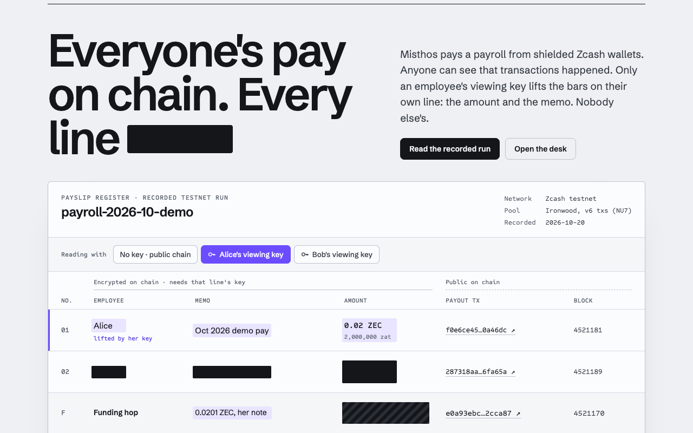

# Misthos · private payroll processing

*Everyone's pay on chain. Every line redacted, except your own.*



**Misthos** (Greek μισθός, "wages") is the product name; the repo is `zec-private-payroll`, the Cargo package is `zec-payroll` (library crate `zec_payroll`), and the CLI is `payroll`. It is a portfolio project, not a Zecathon entry.

This is private payroll processing for the Zcash **testnet**. An employer runs payroll from the **payroll desk** in the browser (`payroll serve --payouts`, then http://127.0.0.1:8787/desk): upload the roster, review it against caps, press Run payroll and watch each employee get funded, scheduled and paid, then issue each employee a signed payslip file, check proofs, and hand the accountant the period ledger. The desk runs the same commands as the CLI. An employer loads a CSV roster. `payroll pay` pays the batch in one shielded `quicksend`; `payroll pay --two-step` pays through one child wallet per employee (one funding transaction, then one payout per employee), so the employer can export a signed proof of one employee's pay. An accountant gets a read-only ledger headed by the employer's viewing key.

## See it in 60 seconds
No `.env`, wallet or key needed:
```
PAYROLL_ROSTER_CSV=e2e/fixtures/roster.csv cargo run -- serve
```
The first (cold) build takes about 2.5 minutes. Then open http://127.0.0.1:8787 for the payslip (the recorded testnet run below; the key buttons switch between no key, Alice's key and Bob's key), and http://127.0.0.1:8787/desk for the payroll desk, which shows a red **Setup required** panel naming every unset chain variable; you can still review the roster against caps. Without `--payouts` the desk cannot pay (`POST /api/payroll/run` answers `410 Gone`). The roster is two synthetic testnet addresses (`e2e/make-fixtures.py`); nothing is sent.

## Proven on testnet
**From the payroll desk, 2026-10-28** (label `payroll-oct-2026`, run with Run payroll in the browser, payout delays set to 1..=2 blocks for the demo film): funding [`82ca8b30…0b6ea3`](https://testnet.zecblock.com/tx/82ca8b30e90fb8cfc83a5de87a8aab31a781545cfaf559f30b85322aa30b6ea3) mined at 4550378 (40,000 + 30,000 zat to the two child wallets); Alice [`44686ece…744a2c`](https://testnet.zecblock.com/tx/44686ece01d2daebb0dc26a6bfe9a76fbc501e67ed617fa662c25132d3744a2c) at 4550386 (30,000 zat) and Bob [`3ff05411…40ac7b`](https://testnet.zecblock.com/tx/3ff05411f5f83433422f0a065d114ef3c1eb3dbd951dbeb67d52b93d2c40ac7b) at 4550389 (20,000 zat). Running the period again skipped both (nobody funded or paid twice). From the desk, each employee's payslip file opened only that employee's line (`verify-proof --lwd`), and the proof check rejected Alice's file on Bob's payout, a 10× amount, and the funding txid. These used a demo employer key (public key `9dc24a9d…24b7f1`, passed with `PAYROLL_EMPLOYER_PUBKEY`), not the one in `docs/employer-pubkey.txt`.

On 2026-10-20 a funded two-employee run (label `payroll-2026-10-demo`, Ironwood pool, v6 txs) went through [testnet.zec.rocks](https://testnet.zec.rocks):
- Funding [`e0a93ebc…2cca87`](https://testnet.zecblock.com/tx/e0a93ebccc788ba5d6570478b927ebf1758318c0012f2d95ddda6624ef2cca87), height 4521170: 2 × 2,010,000 zat (0.0402 ZEC) to the two child wallets.
- Alice [`f0e6ce45…0a46dc`](https://testnet.zecblock.com/tx/f0e6ce4569f9a310b3ab936672331f947c5cadb102c3d5b50bcf2181910a46dc), height 4521181 (+11), and Bob [`287318aa…6fa65a`](https://testnet.zecblock.com/tx/287318aa4e0f0c55ca8b6814cb56b51264ce9dbfd549fcc8ef3db57ea06fa65a), height 4521189 (+19): 2,000,000 zat each.
- `verify-proof --lwd` accepted each employee's signed proof against `docs/employer-pubkey.txt` and rejected the other employee's txid, the funding txid, a changed amount, period or signature, and a different employer key.
- Details: "Live testnet run" below. Test counts: [TESTING.md](TESTING.md).

## Status (honest)
| Part | State |
|---|---|
| Core engine: employees, schedules, pay runs, per-run caps, run status machine | **Done**, unit tested (`cargo test`: 82 lib tests in total; every count is in [TESTING.md](TESTING.md)) |
| CSV import and validation (`payroll plan`) | **Done**, offline only |
| Env config that fails loudly | **Done** |
| Recipient address decoding (`zcash_address` 0.14.0-pre.2) | **Done**: full decode (checksum, F4Jumble, typecodes); testnet only; must have a Sapling or Orchard receiver (`utest1…` UA or `ztestsapling1…`). Mainnet and transparent-only are refused |
| ZIP-321 URI (`src/zip321.rs`) | **Done**, offline-tested. Shown for display/audit only; zingo-cli does not accept ZIP-321 URIs |
| Building + broadcasting the tx | **Delegated to zingo-cli** (`ZCASH_WALLET_CLI`) via one `quicksend` with a JSON receiver list. Syntax checked against zingolib source (0a5cb69, 2026-10-19) and run live against testnet with an unfunded wallet: it syncs and stops at `Insufficient balance (have 0, need 110000 including fee)`. A funded two-step run has since paid out on testnet (see "Live testnet run"). No in-process `zcash_client_backend` builder |
| Payroll desk (`payroll serve --payouts`, `/desk`): roster upload, caps review, Run payroll with live per-employee progress, check-and-rerun of an unknown payout outcome, payslip files, proof check, accountant view. It runs the CLI's own commands. **Unauthenticated**, so loopback only, `Host` checked, CSRF-guarded POSTs. Without `--payouts` it is read-only and its payout endpoints answer `410 Gone` | Built (2026-10-28, lifting the feature freeze on Nick's instruction for a UI payout flow); unit and HTTP tests pass (TESTING.md) and the Playwright E2E runs in Chrome (desktop + 375px); a live two-employee run from the desk on testnet, see "Proven on testnet" |
| Per-employee proof of pay: child wallet per employee, employer-signed (ed25519) `export-proof --employee`, `verify-proof` checks the signature against the published employer key | Built. 7 real-key tests on in-process shielded txs pass (Sapling + Ironwood), including forged / changed-amount / changed-period / network-swap rejection. Both steps are wired to zingo-cli (child wallet per employee, pre-broadcast sync check). Funded two-employee testnet run on 2026-10-20 (Ironwood pool), checked on chain with `verify-proof --lwd`; see "Live testnet run" below |
| Random block delays in `pay --two-step` (funding → payouts, and between employees), polled from lightwalletd's tip | Built; pure scheduling logic unit tested; the gRPC tip query was run live against `testnet.zec.rocks` (2026-10-20). Used in the funded testnet run (see "Live testnet run") |

The tool does not use NEAR Intents, does not use the `zakura-one-time-ivk` crate, and has received no grant funding.

## Requirements
- Rust **1.89**, pinned in `rust-toolchain.toml`. Testnet has activated NU7 (consensus branch `0x77190ad9`, v6 txs): stable `zcash_primitives` 0.30.1 rejects current testnet txs (`invalid consensus branch id 0x77190ad9`) and the stable crates also need Rust ≥1.88, so this repo pins the same prerelease line as zec-shielded-x402 (`zcash_address =0.14.0-pre.2`, `zcash_protocol =0.11.0-pre.1`).
- Other dependencies: `zcash_keys`, `zcash_primitives`, `zcash_client_backend` (with its lightwalletd gRPC client, for `verify-proof --lwd` and the payout delays), `tonic`/`tokio`/`rustls`, `orchard`, `sapling-crypto`, `zip32`, `bip0039`, `blake2b_simd`, `hex`, `ed25519-dalek` 2 (employer signature), `getrandom` (delay draws, key generation). After one `cargo fetch`, `cargo test --offline` works.

- `zingo-cli` from current zingolib needs `nym-proxy` beside it (Mixnet Mode is mandatory for online sessions): `makers bundle-nym-proxy`, or `cargo run --manifest-path tools/workbench/Cargo.toml --bin bundle-nym-proxy -- --release --dest <dir of zingo-cli>`. Without it every wallet call fails with `Mixnet Mode is required for a connected session`.

## Known limits
- The address check decodes and checks network + receiver types, but does not check that the receiver bytes are valid curve points. zingo-cli does, and rejects such an address loudly at send time (`Invalid Orchard receiver in Unified Address`), before anything is broadcast.
- **Timing, headcount and payout shape can link a run on chain.** See the trust model under "Per-employee proof of pay": payouts land a few blocks after funding, the funding tx's action count roughly reveals headcount, and every payout has the same shape.
- **A proof is a bearer document.** `employee_id` and `name` in a proof file are not signed. See "Employer signature".
- **`export-proof` signs the amount in the roster you pass**, not an amount stored in the ledger: use the roster of that pay period.
- **The desk has no login.** Anyone who can reach its port can read the roster and the employer's viewing key; see "Employer dashboard".

## Do X, see Y
1. Run `cargo test`. You should see `82 passed` (unit), `4 passed` (`cli_label`), `1 passed` (`cli_serve`), `8 passed` (`desk_api`), `7 passed` (`proof_real_tx`) and `1 passed` (`sig_attacks`), plus 4 ignored live-testnet tests (counted 2026-10-28; see [TESTING.md](TESTING.md)).
2. Run `cargo run -q -- plan examples/bad.csv`. You should see one error per bad row, for example `line 2: address ... is a MAINNET address`, and the command exits with code 1. Nothing is half-imported.
3. Write a CSV with real testnet Unified Addresses from your own testnet wallets:
   ```
   name,ua,amountZEC,memo
   Alice,utest1...,1.5,"Oct, salary"
   ```
   Then run `cargo run -q -- plan pay.csv --max-total 5 --max-per 2`. You should see a Draft run with each line and an exact zatoshi total. If you go over a cap, every violation is listed at once.
4. Run `cargo run -q -- check-env` without a `.env` loaded. It prints `ERROR: ZCASH_NETWORK not configured` and exits with code 1. If you set `ZCASH_NETWORK=mainnet`, it refuses.

## Engine rules
- **Amounts** are stored as integer zatoshis. Parsing is exact to 8 decimals. Negative values, exponents, zero and amounts above 21M ZEC are rejected.
- **Schedules** can be weekly, biweekly (anchored to a date) or monthly. Monthly schedules on day 29–31 fall back to the last day of the month.
- **Caps** are checked per run: a maximum total, a maximum per employee and a maximum number of recipients (default 50, a policy setting rather than a consensus rule). Caps are checked again at approval, so a cap tightened after planning still applies.
- **Double-pay guard:** each period (`schedule@date` or `adhoc:<label>`) can have only one live run in one process. A new run for the same period is allowed only after the earlier one is marked `Failed`. Across restarts, `pay --two-step` relies on the per-child ledger (below), and refuses a label with whitespace because the ledger could not read it back.
- **Status flow:** `Draft → Approved → Broadcast{txid} → Confirmed{height}`, with `Approved | Broadcast → Failed`. Any other transition is an error.
- Memos are limited to 512 bytes (ZIP-321).

## Layout
- `src/`: `money.rs` · `date.rs` · `employee.rs` · `schedule.rs` · `engine.rs` · `csv.rs` · `config.rs` · `zip321.rs` · `wallet.rs` (zingo-cli, per-child ledger, wallet-DB lock) · `chain.rs` (lightwalletd gRPC) · `delay.rs` (block delays) · `disclosure.rs` (child wallets, proof files) · `attest.rs` (employer ed25519 signature) · `audit.rs` (accountant CSV) · `server.rs` (the desk) · `lib.rs` · `main.rs` (the CLI).
- `ui/index.html`: the landing and recorded payslip. `ui/desk.html`: the payroll desk. Both dependency-free and compiled into the binary.
- `tests/`: `cli_label.rs` (CLI guards: `--label`, wallet-DB lock, export-proof usage) · `cli_serve.rs` (loopback-only serve) · `desk_api.rs` (the desk in payout mode over real HTTP; the wallet CLI is `false`, so nothing is sent) · `proof_real_tx.rs` (real-key proofs, verify-proof CLI) · `sig_attacks.rs` (signature forgeries) · `testnet.rs` (live, `--ignored`).
- `e2e/`: Playwright suite in Google Chrome against the real binary (`stack.sh`, `tests/`, `fixtures/`, `make-fixtures.py`).
- `scripts/testnet-two-employees.sh`: the live two-employee check. `examples/bad.csv`: a roster that fails loudly. `docs/employer-pubkey.txt`: the published demo employer key.

## Shielded payout + accountant export
- `payroll pay <file.csv>`: plans and approves the run, prints the ZIP-321 URI, then runs `ZCASH_WALLET_CLI --chain testnet --server $ZCASH_LWD_URL --data-dir $ZCASH_WALLET_DB --waitsync quicksend '[{"address":…,"amount":<zatoshis>,"memo":…},…]'` (one proposal for all recipients; zingolib normally makes one tx but may split it). It prints `BROADCAST txid=…` for each txid in zingo-cli's `{"txids":[…]}` output. A non-zero exit, or output without a `txids` array, is an error; nothing is marked broadcast. If a var is missing it prints `ERROR: <VAR> not configured` and exits 1.
- `payroll audit-export <file.csv> [txid]`: writes a CSV ledger (run, txid, line index (row order, not the on-chain output index), name, address, amount, memo), headed by `ZCASH_AUDITOR_UFVK`. It refuses spending keys and seed phrases.
- `cargo test --offline`: offline unit tests (ZIP-321 encoding, key checks).
- `cargo test --test testnet -- --ignored`: real testnet tests. Without env vars they FAIL with `TESTNET TEST CANNOT RUN: <VAR> not configured`.
- `audit-export`'s optional `[txid]` is taken from the operator as-is (it must be 64 hex) and is NOT checked on-chain.
- Verified on testnet: a real paid two-step run (see "Live testnet run").

## Rules
The tool uses only the real Zcash testnet, with no mocks and no fake chain data. Unit tests use correctly encoded but synthetic testnet addresses that are never broadcast. Secrets go only in `.env` (see `.env.example`). Mainnet is refused in code.

## Employer dashboard: the payroll desk

Read-only: `set -a; . ./.env; set +a; cargo run -- serve` (default `--addr 127.0.0.1:8787`). Payout mode: `cargo run -- serve --payouts`, which also needs `PAYROLL_EMPLOYER_SEED`, `PAYROLL_CHILD_BIRTHDAY` and the signing key. Open http://127.0.0.1:8787/desk. Without a `.env`, use the 60-second command at the top.

**What the desk does with `--payouts`** (it adds no payment logic: every chain action is this binary's own command, started as a child process, so the ledger, locks, checks, delays and signatures are the CLI's):
- **Run payroll**: upload a roster CSV (every bad line is listed and nothing loads), review it against caps (every violation listed at once), then **Run payroll** starts `payroll pay <snapshot> --two-step --label <period>`. The desk saves the roster each period was run with (`<ZCASH_WALLET_DB>/desk/<period>.csv`) and refuses a rerun of that period with a different roster. While it runs, the page shows the block timeline (funding block, each payout target, the tip), each employee's steps (wallet ready, funded, scheduled, paid, with explorer links) and a plain-language activity feed of the run's output.
- **Failure, check and rerun**: a stopped run shows the CLI's reason. A payout whose outcome is unknown (`pay-pending`) gets **Check on chain** (zingo-cli `balance` and `value_transfers` on that child wallet). **Record as not sent** writes `pay-failed` only if the wallet still holds the payout plus its fee and shows no send that did not fail; otherwise the desk refuses and leaves it for a manual check. Running the period again skips anyone already funded or paid.
- **Payslips**: the period register with redaction bars. **Issue <name>'s payslip** runs `export-proof` for that one employee; opening a line with that key runs `verify-proof --lwd` and lifts only that line.
- **Proof check**: verify a payslip file against the chain, plus three live cheat attempts (another employee's payout, a 10× amount, the funding txid), each refused by the real check.
- **Accountant**: the period ledger (pay, memo, funding and payout txids, payout block, status) with the employer's viewing key, and a CSV download.

**The desk has no login.** `/api/state` returns the full roster and `/api/audit` returns the employer's viewing key (`ZCASH_AUDITOR_UFVK`) to anyone who can reach the port. So: `serve` refuses a non-loopback `--addr` (e.g. `0.0.0.0:8787`) unless you pass `--allow-remote`, and then prints a warning; `--payouts` is refused on any non-loopback address, even with `--allow-remote`; every request whose `Host` is not `127.0.0.1`, `localhost`, `[::1]` or the bound host gets `403` (this blocks DNS rebinding from a web page); every POST needs `X-Misthos-Desk: 1`, a JSON body and (if the browser sends one) a same-site `Origin`, so a page on another site cannot start a payout (CSRF); bodies are capped at 256 KiB; each connection has 5 s read/write timeouts, a 16 KiB cap on the request line plus headers (`431`), at most 64 header lines, and at most 64 connections are served at once (`503`).

**Without `--payouts`** the desk is read-only: it shows the roster, plans against caps and checks proofs, and its payout endpoints answer `410 Gone` pointing to `--payouts`. `POST /api/run` (the old one-shot treasury payout, which could not be proven per employee) and `GET /api/proof` answer `410 Gone` in both modes.

The landing page at http://127.0.0.1:8787 is the **Misthos payslip** of the recorded 2026-10-20 testnet run (static, recorded data, not a live query). The UI is two dependency-free HTML files (`ui/index.html`, `ui/desk.html`), compiled into the binary. They load Schibsted Grotesk and Sometype Mono from Google Fonts and fall back to system fonts offline.

### Browser E2E (`e2e/`)
Playwright in the installed Google Chrome, desktop 1280×800 and mobile 375×812, with video and traces. It runs against the real `payroll serve` binary (no mocks), started with a clean environment so no `.env`, seed or signing key is loaded:
```
CARGO_BUILD_JOBS=2 cargo build && cd e2e && npm install
npm run stack          # 4 desk servers on 127.0.0.1:8791-8794; PIDs in e2e/.run/pids
npm run test:e2e       # 21 tests x 2 viewports
npm run stack:stop     # kills those PIDs
```
8791 has no chain vars (Setup required), 8792 has all five (the auditor UFVK is a synthetic, correctly encoded fixture key from `e2e/make-fixtures.py`, owned by no wallet), 8793 sets `ZCASH_NETWORK=mainnet` (refused), and 8794 runs `--payouts` with `ZCASH_WALLET_CLI=false`, the public BIP 39 test-vector seed and a throwaway signing key, so every pay run stops at the CLI's own pre-broadcast check. The roster is two synthetic testnet UAs built the same way as the unit tests' `ua('p')`; nothing is ever sent on chain. Counted 2026-10-28: 42 passed (21 desktop, 21 mobile).

## Per-employee proof of pay

The employer can export, for one employee, a proof of one payout (amount, recipient, memo, txid, block) that a lender or tax office checks against the chain, without exposing the rest of payroll. The proof shows that this employer's child wallet paid a recipient; it does not show who is holding the file (see "Employer signature").

**Design chosen: one child wallet per employee.** Each employee gets a child seed: 32 bytes = keyed BLAKE2b-256 (key = employer BIP 39 seed, personalization `zecpayroll_child`, input = the employee's payout address). It is encoded as a 24-word BIP 39 mnemonic and used at ZIP 32 account 0, in its own zingo-cli data dir at `<ZCASH_WALLET_DB>/children/child-<hash of address>`. Only the employer seed is needed to rebuild every child wallet. Payout addresses are the input because roster ids are row numbers that change on reorder, so a new payout address means a new child wallet. Duplicate addresses are refused. The treasury (employer seed, account 0) viewing key is **never exported**: `export` refuses it.

Why not ZIP 32 accounts under one seed: zingo-cli creates exactly one account per wallet (`no_of_accounts = 1`), so it could not spend from account N. A separate child seed makes step 2 an ordinary `quicksend`. Why not ZIP 311 payment disclosures: ZIP 311 is still a draft, and the pinned crates have no implementation of it. It is future work. It would allow a per-*payment* proof without the extra funding transaction.

**Two-step payout (one extra tx per employee per run), `payroll pay <csv> --two-step`:**
0. **Pre-broadcast check:** every employee's child wallet is created (restored from its mnemonic at `PAYROLL_CHILD_BIRTHDAY`, passed through the `ZINGO_SEED` env var, never argv) or opened, and synced (`balance --waitsync`). If any child wallet fails, the run stops and **step 1 is not sent**.
1. **Funding:** the treasury sends `pay + 0.0001 ZEC` to each child wallet's UA, in one `quicksend`. This costs the normal ZIP 317 fee of `5_000 zat x max(2, logical actions)`.
1b. **Delays:** the command polls lightwalletd (`GetTransaction`) until the funding tx is mined at height `F` (`PAYROLL_FUNDING_CONFIRM_TIMEOUT_SECS`, default 3600). Payouts then begin at `F + d0`, and the employees go one after another in roster order, each `d_i` blocks after the previous one: `target_i = F + d0 + d_1 + … + d_i`. Every `d` is drawn from the OS RNG, uniformly in `PAYROLL_DELAY_MIN_BLOCKS..=PAYROLL_DELAY_MAX_BLOCKS` (default `2..=6`; min > max, non-numbers and > 1000 are refused before anything is sent). Each target height is written to that child's ledger (`pay-at <period> <height>`) **before** any waiting. The tip is polled every 30 s with `GetLatestBlock`, and lightwalletd must answer once before step 1 is sent.
2. **Payout:** when the tip reaches an employee's target, that child wallet makes one `quicksend` of `pay` to the employee. Funding is exact, so this is 1 note in and 1 output with no change, which costs `10_000 zat` (2 padded actions x 5_000). That fee is what the 0.0001 ZEC top-up covers. Outputs are encrypted with the child wallet's OVK. The command retries every 30 s until the funding note is spendable. Each employee's `PAYROLL_STEP2_TIMEOUT_SECS` (default 1800) starts only when **that employee's** delay ends, so a long stagger never eats into a later employee's retry window. On timeout it exits 1 and names the unpaid employees, and the funds stay in child wallets the employer seed can rebuild.

**Rerun / restart safety:** each child dir has an append-only `payroll-ledger` (`fund-pending`, `funded`, `pay-at`, `pay-pending`, `pay-failed`, `paid`, per period). Rerun with the same `--label` (same period): children already `funded` are not funded again, children already `paid` are skipped, and only the rest go through step 2. A child waiting on its delay is still `funded`, so a rerun never funds it again; it reuses the first `pay-at` height in the ledger instead of drawing a new one. If the run died between funding and writing the targets, the rerun looks up the recorded funding txid's mined height and schedules from there. A `*-pending` with no outcome (crash or unclear zingo-cli error after a possible broadcast) makes the whole run refuse until someone checks that child wallet on chain and fixes the ledger. Zingo-cli errors at proposal time (`Insufficient balance`, `Propose send error`) count as "nothing broadcast" and are retried. The in-memory engine's double-pay guard does NOT survive a restart; the ledger is what does. A different `--label` is a different period and pays again, by design, so `pay --two-step` and `export-proof` now refuse to run without an explicit `--label` (the old default was the CSV path, so `./roster.csv`, `roster.csv` or a copied/moved roster were each a new period and would have funded and paid everyone again). An unreadable ledger (anything but missing) stops the run instead of reading as empty, and clearing a `fund-pending` marker rewrites the ledger atomically. Only one `pay --two-step` runs per wallet DB at a time: it takes an exclusive lock on `<ZCASH_WALLET_DB>/payroll.lock` before reading any ledger and holds it until it exits, and a second run stops with `another pay --two-step is running for this wallet DB …; nothing sent` (two concurrent runs would both read `Fresh` and both fund). Labels with whitespace are refused (before this change, the default label was the CSV path, and a path with a space never matched on read-back, so a rerun would have funded again).

Child dirs are created `0700`, because zingo-cli writes the child seed into `zingo-wallet.dat`.

**Verified live (2026-10-20, testnet.zec.rocks, throwaway unfunded seed):** zingo-cli at zingolib 0a5cb69 reads `ZINGO_SEED` (upstream feature, `zingo-cli/src/lib.rs`), restored both child wallets with `--birthday`, and the seed never showed up in the process list. The UA zingo-cli shows for the child has the same Orchard receiver as the funding UA this tool computes, so funding lands in the wallet zingo-cli can spend. The run then stopped at step 1 with `Insufficient balance (have 0, need 330000 including fee)`. A funded run of both steps followed; see "Live testnet run" below. If a first restore fails halfway, delete that child dir before retrying.

**What the export contains:** the child wallet's account-0 **full** viewing key (UFVK `uviewtest1...`). It is a full key, not an incoming-only one, because payouts are *outgoing* from that wallet and are recovered with its OVK. Trust model:
- It reveals **all** of that employee's payouts from this employer, past and future (not just one), plus the funding notes into that wallet, the amounts, and the employer-chosen memos. Anyone holding the file can see this forever. There is no revocation.
- It reveals nothing about other employees' child wallets or the treasury. Child seeds are one-way from the employer seed, so a child key reveals nothing about the employer seed. Tests show that A's key cannot decrypt B's payout, even when both outputs are in the same transaction, and that it sees only its own funding output in a shared funding transaction.
- The employer signs each proof (see **Employer signature** below), so a proof made by an employee from their own wallet, or signed with any key other than the published employer key, is rejected. The signature is only as good as the verifier's source for the employer public key.
- The sending side of the treasury -> child wallet funding tx is not hidden from the treasury key holder, of course.
- **Timing can still link funding and payouts on-chain.** The random block delays (default 2–6 blocks for `d0` before payouts start, then 2–6 more per employee) mean a payout no longer lands in the block right after its funding tx. The target height of the last of N employees is 2·(N+1) to 6·(N+1) blocks after funding, and the mined height can trail its target, because step 2 broadcasts only once the tip reaches the target and then retries every 30 s until the funding note is spendable. On the recorded run (N=2) the payouts were mined 11 and 19 blocks after funding; 19 is past the 18-block default maximum target for that reason. Anyone watching sees a funding tx followed within a few dozen blocks by N shielded payouts. On a quiet chain like testnet, with few other shielded txs in that window, that pattern alone can tie them together. The delays shrink the signal; they do not remove it.
- **Headcount shows.** The funding tx's public action count (3 for the 2-employee run) roughly reveals how many people were paid.
- **Every payout has the same shape:** 1 note in, 1 output, 2 actions and a 10,000 zat fee, sent in roster order. That fixed shape helps link payouts to their funding tx.
- `pay --two-step` asks lightwalletd directly (not through zingo-cli's mixnet) for the funding tx by txid to learn its mined height. That tells the lightwalletd operator which IP is interested in that txid right after it was broadcast. Tip polling (`GetLatestBlock`) reveals nothing.
- The seed (`PAYROLL_EMPLOYER_SEED`, a BIP 39 mnemonic) is never printed. `EmployerSeed`'s `Debug` output is redacted.

**Employer signature:** the treasury signs, with ed25519 (`ed25519-dalek`), this exact message for each step-2 payout:
```
zec-payroll-employer-attestation v1
network=testnet
txid=<payout txid>
child_address=<the employee's child wallet UA, which sent the payout>
amount_zat=<amount paid to the employee>
pay_period=adhoc:<label>
```
Every field is one line; values with whitespace or control characters are refused rather than escaped. **`employee_id` and `name` are NOT signed:** anyone holding the file can edit them and the proof still verifies, so `verify-proof` prints the id only on its own line, `employee_id (NOT signed; as written in the file): …`, never on the `VERIFIED ON CHAIN` line. The proof is a bearer document: it proves a payout from this employer's child wallet, not who holds the file. A lender should match the `PayoutOut` recipient bytes that `verify-proof` prints against the borrower's own address. The signing key comes from `PAYROLL_EMPLOYER_SIGNING_KEY` (64 hex chars) or `PAYROLL_EMPLOYER_SIGNING_KEY_FILE` (refused if group- or other-readable). It is never printed, and its `Debug` is redacted. The public key is published in [`docs/employer-pubkey.txt`](docs/employer-pubkey.txt) (a demo testnet key; its signing key is in a 0600 file outside git) and repeated inside each proof. `verify-proof` checks, in order and before any network call: the proof says `network=testnet`; the signer named in the proof **equals** the expected employer key (`--employer-pubkey`, else `PAYROLL_EMPLOYER_PUBKEY`, else `docs/employer-pubkey.txt` in the **current directory**; in that last case it prints `WARNING: employer key taken from <absolute path> in the current directory`, because whoever hands you that folder chooses the key, so pass `--employer-pubkey` from a source you trust); the signature is valid (`verify_strict`) over the fields rebuilt with the verifier's own network; the UFVK in the file is the signed child wallet's key; and the txid argument is the signed txid. After decrypting, the tx must pay out exactly the signed amount. Tests reject a forged employee proof (own wallet, own key), a forgery that names the employer's key, a changed amount, a changed period, a testnet↔mainnet swap, a duplicated field line, the signature moved onto another employee's UFVK, and A's proof shown B's tx.

**Setup notes (from the live run):**
- Quote the signing-key path when it contains a space: `PAYROLL_EMPLOYER_SIGNING_KEY_FILE="$HOME/My Keys/employer.key"`. Unquoted, the shell splits it at the space.
- Don't export `ZINGO_SEED` in your shell. Payroll sets it per child wallet on each zingo-cli call; a global value makes zingo-cli try to restore an existing child wallet again.

**Live testnet run (2026-10-20, label `payroll-2026-10-demo`, independently re-checked against testnet.zec.rocks):** all three txs are v6 (NU7 branch `77190ad9`), Ironwood only, with no transparent inputs or outputs and no Sapling/Orchard bundle. Funding [`e0a93ebccc788ba5d6570478b927ebf1758318c0012f2d95ddda6624ef2cca87`](https://testnet.zecblock.com/tx/e0a93ebccc788ba5d6570478b927ebf1758318c0012f2d95ddda6624ef2cca87) (height 4521170, 3 actions) sends 2,010,000 zat to each child wallet. Alice [`f0e6ce4569f9a310b3ab936672331f947c5cadb102c3d5b50bcf2181910a46dc`](https://testnet.zecblock.com/tx/f0e6ce4569f9a310b3ab936672331f947c5cadb102c3d5b50bcf2181910a46dc) (4521181) and Bob [`287318aa4e0f0c55ca8b6814cb56b51264ce9dbfd549fcc8ef3db57ea06fa65a`](https://testnet.zecblock.com/tx/287318aa4e0f0c55ca8b6814cb56b51264ce9dbfd549fcc8ef3db57ea06fa65a) (4521189) each pay out 2,000,000 zat, memo "Oct 2026 demo pay". `verify-proof --lwd` accepts each proof with the key in `docs/employer-pubkey.txt` and rejects the other employee's txid, the funding txid, a changed amount, a changed period, a changed signature and a different employer key. Each UFVK sees its own funding and payout and nothing in the other employee's payout. On a quiet testnet the timing (payouts 11 and 19 blocks after funding, 8 blocks apart) can still link them; see the trust model above.

**Commands:**
- `payroll keygen-signing <key-file>`: new employer signing key, file created 0600, never overwritten. Prints only `employer_pubkey=<hex>`; publish it.
- `payroll export-proof <roster.csv> --employee <id|name> --label <label>`: prints the signed proof file for **that one employee only**. The txid comes from that child's ledger (`paid` for `adhoc:<label>`), never from the command line; with no payout, or an ambiguous multi-txid payout, it refuses. If `--employee` matches more than one entry (an id and a name), it refuses, and roster names shaped like `row<N>` are refused at import; it prints `exporting proof for <name> <address…>` to stderr first. **The signed amount comes from `<roster.csv>`**, not from the ledger: the roster must hold the amount paid in `<label>` (after a raise, use the roster of that period), or `verify-proof` rejects the genuine payout as `AmountMismatch`. Needs `PAYROLL_EMPLOYER_SEED`, the signing key, and the chain config (to find the child dir).
- `payroll verify-proof <proof-file> <txid> --lwd https://testnet.zec.rocks:443 [--employer-pubkey HEX]`: the third-party check **against the chain**. After the signature checks above, it fetches the raw tx and its mined height from lightwalletd (`GetTransaction`), refuses a tx that is unknown or only in the mempool, checks the txid, trial-decrypts with the UFVK, checks the signed amount, and prints each visible output with its direction (`PayoutOut`/`FundingIn`/`Change`), pool, amount, recipient receiver bytes and memo. It exits 1 with "sees nothing" if the transaction isn't this employee's. The lightwalletd fetch was live-checked against a real testnet tx and a made-up txid; also run on the live payouts below.
- `payroll verify-proof <proof-file> <raw-tx-hex-file> <txid> <block-height> [--employer-pubkey HEX]`: **offline mode, trust-only for the chain part.** The signature is still checked, but the tx bytes and height are whatever the supplier gave you; they are not checked on chain. The height only selects consensus rules. The output says `DECRYPTED OFFLINE (NOT checked on chain ...)`. The v6 txid commits to effects, not proofs or signatures, so flipping proof/signature bytes can keep the txid, but what the lender sees cannot change (tested byte by byte).
- The dashboard does not export proofs (`/api/proof` is `410 Gone`).

**Tests:** `tests/proof_real_tx.rs` uses real ZIP 32 keys, real note encryption with each child wallet's OVK, real Halo2 proofs for Ironwood, and real ed25519 signatures. Synthetic parts: the transparent inputs spend made-up outpoints, and the Sapling zk-proof bytes are sapling-crypto's mock proofs, so the chain would reject these transactions. The verifier never checks zk-proofs (it trial-decrypts outputs and checks the signature), so what it reads is the same as for a mined tx; the live run above is the on-chain check. The live check `scripts/testnet-two-employees.sh` and the `--ignored` test `testnet_employee_a_key_cannot_see_employee_b_payout` need a funded step-2 payout; without the required variables they exit or panic, naming the missing variable. `cargo test --test testnet -- --ignored lightwalletd_grpc_tip_height_for_delays` (needs `ZCASH_LWD_URL`) checks the tip query the delays use; it printed `testnet tip 4521111` against `testnet.zec.rocks` on 2026-10-20.

The older auditor export (`ZCASH_AUDITOR_UFVK`) is the *employer* key and shows all of payroll. It is for the company's accountant only, never for employees.
